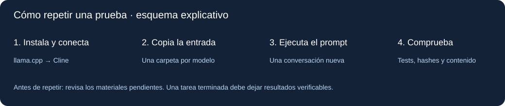

# LFM2.5 frente a Qwen3.6: tres pruebas con Cline

Materiales para seguir y repetir la comparativa de **LFM2.5-24B-A2B Q4_K_M** y **Qwen3.6-35B-A3B Q4_K_M**, usando Cline y llama.cpp, con **131 072 tokens (128K) configurados**.

**Materiales de la comparativa, con resultados y límites documentados.** Las pruebas 2 y 3 tienen muestras y resultados comprobables. Los tres prompts originales están incluidos. El origen exacto de los dos GGUF está confirmado por hash. La ejecución de Liquid en gastos está identificada, pero no se ha recuperado su aplicación final intacta: faltan el CSS y una copia del HTML anterior a una tarea posterior de Qwen en el mismo espacio compartido. Las tareas pueden repetirse con los prompts originales; los límites de la reproducción exacta de la grabación se detallan en la documentación.



## Empieza aquí

1. Lee [qué está verificado y qué falta](docs/estado.md).
2. Sigue [instalación y configuración, paso a paso](docs/guia.md). Incluye descargas, servidor local, Cline, comprobación de contexto y solución de problemas.
3. Prepara carpetas nuevas con `python herramientas/preparar.py`. No trabaja sobre los resultados guardados.
4. Abre solo una carpeta de trabajo en VS Code, inicia una tarea nueva de Cline y pega el contenido completo de `prompt.txt` de esa prueba, idéntico para los dos modelos.
5. Evalúa tus resultados con las instrucciones de cada prueba: [gastos](pruebas/01-gastos/README.md), [inventario](pruebas/02-inventario/README.md) y [organización](pruebas/03-organizacion/README.md).

Para consultar los resultados guardados no necesitas descargar modelos ni instalar Cline. Basta Python para comprobar inventario, clasificación e integridad:

```powershell
python herramientas/verificar.py
```

## Resultados de estos tres casos

| Caso | Liquid | Qwen | Qué permite afirmar |
|---|---|---|---|
| Aplicación de gastos | Resultado final intacto no recuperado; archivos supervivientes alterados después | HTML conservado; ingreso/gasto y persistencia comprobados ahora; carga jQuery y desborda en móvil | No se puntúa Liquid usando archivos posteriores; Qwen incumple ausencia de dependencias y presenta límites de diseño móvil |
| Inventario Python | 4/4 tests | 4/4 tests | Ambos pasan los mismos cuatro tests originales; no garantiza corrección para cualquier entrada |
| Organización por contenido | 2/10 únicos bien clasificados; entrada final vacía | 10/10; conserva 12 originales | Ambos conservan 10 contenidos únicos y detectan dos duplicados; el CSV de Liquid tiene problemas de significado |

La comprobación del inventario y de los archivos se ha repetido sobre las copias de este paquete. No se han vuelto a ejecutar las tareas con los modelos. La aplicación Qwen sí se ha revisado ahora en navegador; sus capturas y alcance están en [la revisión de gastos](pruebas/01-gastos/revision-navegador.md). Consulta [el informe de verificación](docs/verificacion.json) y la [auditoría de organización](pruebas/03-organizacion/auditoria.md).

## Cómo leer la comparación

Son **tres casos cotidianos**, sin repeticiones estadísticas ni cobertura de todas las tareas agénticas. No refutan por sí solos los benchmarks de ningún desarrollador ni permiten afirmar que un modelo siempre supera a otro. Las arquitecturas y tamaños son diferentes; usar Q4_K_M en ambos no supone idéntica precisión ni pérdida de calidad.

Los perfiles locales actuales tienen diferencias de muestreo, caché y MTP. Los registros recuperados confirman qué modelo se seleccionó en cada tarea, seguimientos en gastos y aprobaciones automáticas de algunas acciones; no fijan todos los parámetros de generación. Consulta la [trazabilidad](docs/trazabilidad.md). 128K es capacidad configurada, no evidencia de haber llenado o procesado 128K tokens en estas tareas. Los resultados futuros pueden variar con la versión de Cline, llama.cpp, plantilla de chat, hardware, ajustes y aprobaciones. Revisa [configuración y límites](docs/configuracion.md).

## Qué contiene

```text
docs/                       Guía, límites, enlaces y verificación
assets/                     Esquemas explicativos, no capturas de la grabación
pruebas/01-gastos/           Prompt original, HTML de Qwen y material compartido; faltantes señalados
pruebas/02-inventario/       Prompt original, inicio defectuoso y dos versiones corregidas
pruebas/03-organizacion/     12 originales ficticios, prompt, resultados y CSV
herramientas/               Preparación sin sobrescrituras y comprobaciones
SHA256SUMS.json             Huellas de los archivos distribuidos
```

No se incluyen pesos de modelos ni bibliotecas de terceros. Este repositorio no concede una licencia adicional de redistribución. Las licencias de los programas y modelos enlazados siguen siendo las de sus autores.
