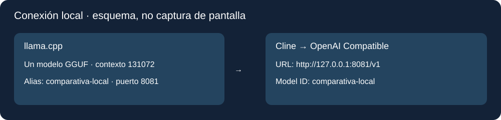

# Guía paso a paso · Windows, llama.cpp y Cline

## 1. Qué necesitas y qué puedes comprobar sin descargar modelos

Para revisar archivos y repetir las comprobaciones bastan Windows, un navegador y Python 3.10 o posterior. Para ejecutar agentes necesitas además VS Code, Cline, llama.cpp, los dos modelos GGUF y suficiente RAM/VRAM para el contexto elegido. Las descargas de pesos son grandes; no vienen incluidas. Consulta tamaños y límites en [configuración](configuracion.md).

Todos los enlaces se enumeran en [fuentes](fuentes.md). Los GGUF de terceros se distinguen del autor del modelo. No descargues una variante UD-Q4_K_M suponiendo que es idéntica a Q4_K_M.

1. Instala Python desde su web oficial. En el instalador de Windows activa **Add python.exe to PATH** si aparece. Abre un terminal nuevo y ejecuta `python --version`. Si Windows abre la tienda o dice que no existe, revisa la instalación antes de continuar.
2. Instala VS Code desde su web oficial. Ábrelo.
3. En VS Code pulsa **Extensiones**, busca **Cline**, comprueba que es el proyecto Cline y pulsa **Instalar**. El enlace oficial de la extensión está en las fuentes.
4. Descarga o copia este paquete a una carpeta propia, por ejemplo `C:\Comparativa`. En GitHub, pulsa **Code → Download ZIP** y después **Extraer todo**. Abre la carpeta que contiene este README, no la carpeta superior del ZIP.
5. Elige **Archivo → Abrir carpeta** en VS Code. Luego **Terminal → Nuevo terminal**. Ejecuta `python herramientas/verificar.py`. Así puedes consultar los resultados sin cargar un modelo.

## 2. Descargar llama.cpp y los pesos

1. Abre las publicaciones oficiales de llama.cpp. Elige un paquete Windows x64 apropiado para tu equipo. Para NVIDIA busca la variante CUDA y sigue las indicaciones de esa publicación sobre bibliotecas CUDA. Si no dispones de NVIDIA, no elijas ese paquete como si fuera universal.
2. Extrae todos los archivos juntos, por ejemplo en `C:\Comparativa\motor`. Debe existir `llama-server.exe`. No copies solo el EXE: sus bibliotecas deben acompañarlo.
3. Crea `C:\Comparativa\modelos` y guarda allí los GGUF. Liquid tiene una descarga oficial Q4_K_M comprobada. Para Qwen descarga el Q4_K_M de ggml-org fijado en las fuentes: su tamaño y SHA-256 coinciden con el archivo local de la comparativa. Es una conversión de ggml-org; el autor original del modelo es Qwen.
4. Anota la versión de llama.cpp: en PowerShell, dentro de `motor`, ejecuta `.\llama-server.exe --version`. Guarda el resultado en tus notas de ejecución.
5. Para comprobar un peso descargado abre PowerShell y usa `Get-FileHash -Algorithm SHA256` seguido de su ruta entre comillas. Compara todos los caracteres con el hash de la fuente elegida. El nombre por sí solo no basta.

## 3. Arrancar un solo modelo a 128K

Estos son ejemplos de configuración para una nueva ejecución, **no comandos históricos verificados del vídeo**. Las rutas son ejemplos públicos. Cambia el nombre de archivo si el GGUF descargado tiene otro nombre.

Abre PowerShell en `C:\Comparativa\motor`. Ejecuta primero Liquid:

```powershell
.\llama-server.exe --model "C:\Comparativa\modelos\LFM2.5-24B-A2B-Q4_K_M.gguf" --alias comparativa-local --host 127.0.0.1 --port 8081 --ctx-size 131072 --parallel 1 --jinja --temp 0.1 --top-k 50 --repeat-penalty 1.05 --cache-type-k f16 --cache-type-v f16
```

Espera a que termine de cargar. Deja esa ventana abierta. En otro terminal:

```powershell
Invoke-RestMethod http://127.0.0.1:8081/health
Invoke-RestMethod http://127.0.0.1:8081/v1/models
```

La primera consulta debe indicar `ok`; la segunda debe incluir `comparativa-local`. Si el servidor no carga por memoria, guarda el error. No sigas como si la carga hubiera funcionado. Los detalles de reparto entre GPU y CPU dependen del equipo y la versión; consulta la ayuda oficial. Un `ok` acredita que está listo, no que haya procesado 128K tokens.

Cuando acabes las tres tareas de Liquid, detén ese servidor con **Ctrl+C** en su ventana. Después puedes arrancar Qwen (ajusta el nombre a tu descarga):

```powershell
.\llama-server.exe --model "C:\Comparativa\modelos\Qwen3.6-35B-A3B-Q4_K_M.gguf" --alias comparativa-local --host 127.0.0.1 --port 8081 --ctx-size 131072 --parallel 1 --jinja --temp 0.6 --top-k 20 --top-p 0.95 --min-p 0 --repeat-penalty 1.0 --cache-type-k q4_0 --cache-type-v q4_0
```

Repite las consultas de salud y modelo. No arranques los dos servidores en el mismo puerto. Para acercarte a los perfiles observados lee la tabla de configuración: este ejemplo omite MTP y el reparto específico de GPU; no permite comparar tiempos con la grabación.

## 4. Conectar Cline al servidor



1. Abre el panel lateral de **Cline** y su rueda de **Settings / Configuración**.
2. En el proveedor de API elige **OpenAI Compatible**. Es un formato de conexión; el servidor de este ejemplo es local.
3. En **Base URL** escribe `http://127.0.0.1:8081/v1`.
4. Si el formulario exige **API Key**, usa el texto ficticio `local`. Solo vale para este servidor sin autenticación enlazado a 127.0.0.1; no publiques claves reales de otros proveedores.
5. En **Model ID** escribe `comparativa-local`, el alias que devuelve `/v1/models`.
6. Si hay un campo **Context Window**, establece `131072`; no confundas contexto con **Max Output Tokens**. Asegúrate de que los modos Plan y Act, si tienen proveedores separados, usan la misma conexión.
7. Desactiva aprobaciones automáticas para revisar cada acción. Usa **Act** para ejecutar la tarea. Si Cline no ve archivos, comprueba qué carpeta abriste con **Archivo → Abrir carpeta**.
8. Antes de medir, en una carpeta vacía de ensayo pide crear `comprobacion.txt` con el texto `conexion local correcta`, aprueba la escritura y ábrelo tú. Este es un ensayo de conexión nuevo, no parte de las tres puntuaciones. Si falla el uso de herramientas, registra el error y revisa plantilla Jinja, soporte del modelo y versiones antes de continuar.

Los esquemas de esta guía son ilustraciones explicativas. Las capturas de aplicaciones incluidas en la revisión de gastos se tomaron el 16 de octubre al examinar los archivos conservados; tampoco son capturas de la grabación original. Los nombres y la posición de los controles pueden variar por versión.

## 5. Crear las copias y realizar las tareas

Desde el terminal de la raíz del repositorio ejecuta:

```powershell
python herramientas/preparar.py
```

Se crean `ejecuciones/liquid` y `ejecuciones/qwen`. Cada una tiene las carpetas de las tres tareas; las de gastos no contienen código inicial, solo el prompt. El preparador se detiene si ya existe `ejecuciones`. Para otra ronda conserva esa carpeta con otro nombre desde el Explorador y vuelve a prepararla.

Abre **una carpeta de una prueba**, no todo el repositorio, para que el agente no vea las soluciones. Cada modelo empieza con la misma entrada y una conversación nueva. Cada carpeta incluye `prompt.txt` con el texto original de su prueba. Abre ese archivo, selecciona y copia todo su contenido, y pégalo en una tarea nueva de Cline. No copies el README ni las soluciones. Repite el mismo texto para el segundo modelo. Sigue el README de cada prueba, sin añadir pistas distintas a uno de los modelos.

Anota modelo y hash, contexto, motor y versión, Cline y VS Code, temperatura, MTP, hora de inicio y final, aprobaciones, errores y cualquier ayuda humana. Si cambias algo a mitad de la tarea, decláralo.

## 6. Resolver problemas frecuentes

| Qué ves | Qué comprobar |
|---|---|
| Conexión rechazada | Que la ventana del servidor siga abierta y `/health` responda |
| Modelo no encontrado | Que el ID de Cline coincida con `/v1/models` |
| Error al cargar DLL | Que hayas extraído el paquete completo y sus dependencias oficiales |
| Sin memoria | Guarda el error y revisa recursos/contexto; no afirmes 128K si lo has reducido |
| Cline describe una acción pero no la hace | Comprueba herramientas y plantilla, aprobaciones y archivos reales; no puntúes una promesa como trabajo terminado |
| El CSV se ve extraño | Importa con coma y su codificación, sin modificar el original |

Para contrastar los resultados guardados ejecuta `python herramientas/verificar.py`. Para puntuar una nueva organización usa el auditor con la ruta de tu carpeta. La evaluación combina tests, hashes y contenido: la frase final del agente no basta.
