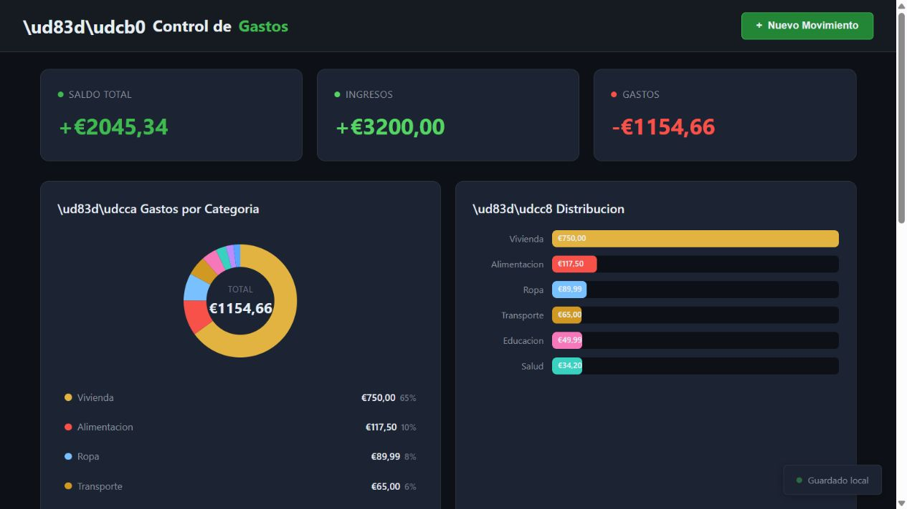
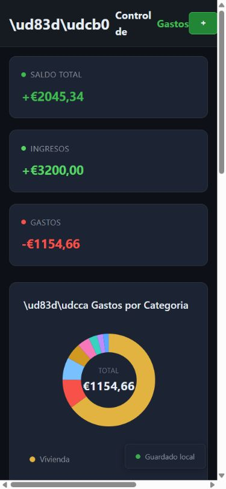
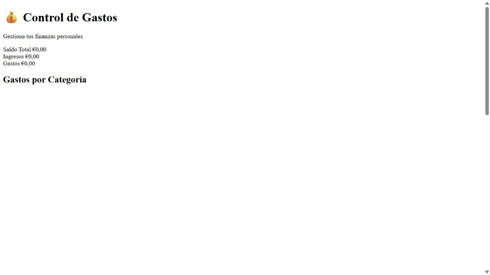

# Revisión actual en navegador · 16 de octubre de 2026

Se han abierto **las copias conservadas**, sin editar el código ni volver a ejecutar los modelos. Los movimientos añadidos son ficticios y solo se guardaron en el navegador de revisión, no en los archivos del repositorio. Estas imágenes no son capturas del vídeo original.

## Qwen

| Comprobación realizada | Observación |
|---|---|
| Apertura en escritorio | Panel, tarjetas, lista y gráficos visibles; diez operaciones iniciales |
| Valores iniciales | Saldo 1975,34; ingresos 3100,00; gastos 1124,66 |
| Añadir ingreso de 100 | Saldo 2075,34 e ingresos 3200,00; movimiento visible |
| Añadir gasto de 30 en Alimentación | Saldo 2045,34 y gastos 1154,66; categoría Alimentación 117,50, gráfico y lista actualizados |
| Recargar | Conserva ambos movimientos y los mismos totales |
| Consola durante apertura, adiciones y recarga | Sin errores o advertencias capturados en esa secuencia |
| Vista móvil solicitada de 390 × 844 | Desbordamiento horizontal: ancho de contenido 585 frente a 375 de zona útil; aspecto revisado en captura |
| Texto visible | Algunas secuencias Unicode aparecen literalmente en encabezados, en lugar de iconos |
| Requisitos de alcance | Incluye carga externa de jQuery y controles adicionales de importación/exportación, filtros y reinicio no solicitados |

La carga externa se observa en el HTML. No se ha realizado una prueba bloqueando jQuery para demostrar si su descarga es necesaria para funcionar. El formulario y persistencia comprobados no equivalen a una validación exhaustiva: quedan sin cubrir todas las entradas inválidas, todos los navegadores, accesibilidad, todas las anchuras y las funciones adicionales.

## Espacio compartido posterior a Liquid

El HTML y el JavaScript supervivientes no encajan: el JavaScript intenta registrar un evento sobre un elemento que no existe en ese HTML. En la apertura actual se observan totales a cero, falta de estilo y un `TypeError` al acceder a `addEventListener` sobre `null` en la línea 130 de `script.js`.

Este fallo describe **la muestra alterada conservada**, no prueba el resultado al terminar Liquid. El HTML fue modificado después de iniciar una tarea de Qwen en esa carpeta y el CSS no se ha recuperado. Por eso no se asigna a Liquid una puntuación funcional usando esta muestra. Consulta la trazabilidad antes de sacar conclusiones.
